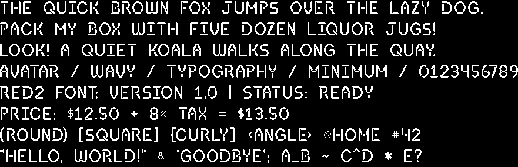

# RED2 Font

I felt like designing a font, so I did.



## Generate font assets

The two entry points are `generate_font.py` for exports and `render_font.py`
for bitmap previews. Implementation code lives in `src/`; tests live in `tests/`.
Python, Pillow, FontTools, and an `aseprite` executable are required.

```sh
python3 -m venv .venv
source .venv/bin/activate
python -m pip install -r requirements.txt

python generate_font.py --spacing 6 --kerning-slack 3 --widen-pairs --export woff,ttf,bram
```

This loads the Aseprite source once, computes one kerning table, and shares that
same table between all selected formats. No separate exporter commands are
needed. Output goes to `dist/` by default.

```sh
# Default: spacing 4, slack 2, two-predecessor placement; WOFF, TTF, and BRAM.
python generate_font.py

# Exact original kerning, without class approximation.
python generate_font.py --kerning-slack 0

# Select WOFF2 in place of WOFF version 1.
python generate_font.py --export woff2,ttf,bram

# Flashable font-v2 header + one 1024 x 32 BRAM payload.
python generate_font.py --export v2

# Only FPGA ROMs, in a separate directory.
python generate_font.py --kerning-slack 2 --export bram --output-dir dist/fpga
```

| Option | Meaning | Default |
| --- | --- | --- |
| `--spacing N` | Optical edge-gap target and vertical search radius, in source pixels | `4` |
| `--kerning-slack N` | Maximum extra origin advance per pair for class compression | `2` |
| `--widen-pairs` | Enforce placement using only the immediately preceding glyph | Off |
| `--export FORMATS` | Comma-separated `woff`, `woff2`, `ttf`, `bram`, `v2` | `woff,ttf,bram` |
| `--output-dir PATH` | Destination directory | `dist` |
| `--source PATH` | Input artwork | `RED2 Font.aseprite` beside the entry points |
| `--aseprite PATH` | Aseprite executable | `aseprite` on PATH |
| `--layer NAME` | Artwork layer to export | `Glyphs` |

`woff` means WOFF version 1 (`.woff`); `woff2` produces `.woff2`. Only selected
formats are written. Existing unrelated files in the output directory are kept.
Run `python generate_font.py --help` for the complete CLI help.

### Shared kerning options

The preparation order is:

1. Compute optical pair advances at the requested spacing.
2. Optionally widen them to satisfy the adjacent-pair invariant.
3. Form classes with the requested kerning slack.
4. Verify the required placement-history invariant before exporting.

**Kerning slack** allows 0 through N extra pixels of origin advance for each
pair. It never tightens a pair. With `--widen-pairs`, this bound is measured
against the widened baseline; otherwise it is measured against the original
optical table. Extra advance can accumulate across a string. Pairs involving
fixed-cell (`k=0`) glyphs remain exact.

Left classes group adjustment rows, and right classes group adjustment columns.
The adjustment is `left.width + spacing - advance(left, right)`. A merged class
block stores its minimum adjustment, and its original maximum-minus-minimum
must be no larger than the slack. Repeated merges cannot accumulate more error
than the per-pair budget.

Among deterministic candidate partitions, selection first minimizes the
power-of-two padded table capacity. Within that allocation, it minimizes counts
of the largest pixel errors, then the next-largest errors, down through 1px.
Exact cell count and stable tie breaks follow. Total widening is diagnostic,
not the objective. On the current artwork, spacing 4 and slack 2 select **29 ×
29 classes**: 125 pairs gain 2px, 540 gain 1px, and 6,560 remain unchanged.

Widening is separate from slack. It repeatedly applies
`d(B,C) = max(d(B,C), d(A,C) - d(A,B))` in ascending glyph order until
`d(A,C) <= d(A,B) + d(B,C)` for every ordered triplet. This is a feasible greedy
construction, not a globally minimum widening. It removes the need to consult A
while placing C, but does not itself save a BRAM block in the existing VGA UART
architecture.

Without widening, generation checks every ordered quadruple to prove the two
previous glyphs dominate every older constraint. With widening it checks the
stronger three-glyph triangle invariant. Glyph changes, spacing changes, or slack
cannot silently bypass these proofs; invalid candidate partitions are rejected.
The current artwork at spacing 0–3 needs more history unless widening repairs it.

## Output files

`dist/font.json` records the source, settings, selected classes, pixel-error
histogram, history proof, and generated file paths for every build.

### Font v2 flash binary

`--export v2` writes `dist/RED2-Regular-v2.bin` for the fpgatool font-v2 demo.
It shares the artwork, spacing, kerning classes, and history proof with all
other formats, and runs independently of the fpgatool checkout.

The 4,256-byte file contains a 160-byte header and 1,024 little-endian 32-bit
BRAM words. Its header holds `RFV2`, version 2, lengths, table bases/counts,
spacing, an additive checksum, and eight Unicode page slots. Payload offsets
are word addresses relative to BRAM, excluding the header. The sum of every
32-bit word in the file is zero modulo 2³². All unused/reserved words are zero.

Header words 0–3 are magic/version/header bytes/payload words; word 4 is used
payload bytes; words 5–9 are metadata/crop/rows/kerning/pattern bases; words
10–13 are glyph/crop/row-byte/pattern counts; words 14–16 are spacing/page
count/checksum; words 17–23 are reserved. Words 24–39 contain eight page pairs.
Directory prefixes are unique. The first page word packs prefix:16, map-word-base:10, encoding:1; the second
packs glyph-base:8, glyph-count:9 (least significant fields first). Encoding 0
packs four mapping bytes per word; encoding 1 uses bits [28:21] of each pattern
word. Missing mappings use byte 255 and fall back to glyph 0 (`.notdef`).

This profile requires `.notdef`, glyphs no larger than 21 × 32, at most 256
glyphs, 32 left/right kerning classes and crop classes, two pattern banks,
2,048 shared row bytes, eight Unicode pages, spacing 0–31, and a payload that
fits one BRAM. Capacity errors fail before replacing published outputs.
The exporter finds the minimum supported pattern-bank count, trying one bank
first and then grouping glyphs across two banks. Each bank holds 256 distinct
pixel rows; rows shared across banks are duplicated. Bit 31 of each glyph's
metadata selects its bank, so all of a glyph's rows stay in that bank. If the
font cannot fit two banks, export reports the pattern count and this constraint.

Font-v2 utilities use the same `generate_font.py` entry point and do not need
Aseprite when operating on existing binaries or fixtures:

```sh
# Validate header/checksum/table bounds, page uniqueness, and glyph row bounds.
./generate_font.py validate-v2 dist/RED2-Regular-v2.bin

# Reproduce an FPGA simulation snapshot from legacy BRAM Python constants.
./generate_font.py v2-reference ../fpgatool/examples/hardware/red2_row_data.py \
  --output ../fpgatool/examples/hardware/red2_font_v2_data.py \
  --binary ../fpgatool/build/reference-font-v2.bin

# Verify complete old/new frames across the FPGA's spacing-change regression.
./generate_font.py verify-v2-reload \
  ../fpgatool/build/basys3/vga_uart_1920_1080_font_v2_capture/sim \
  ../fpgatool/assets/red2-font-v2-notdef.txt \
  --font ../fpgatool/build/reference-font-v2.bin --new-spacing 9
```

The reference fixture is an intentionally fixed historical snapshot. Normal
`--export v2` uses the current artwork. Capture verification decodes the exact
binary used by the simulation and compares every pixel, with UTF-8/editing,
missing-glyph fallback, kerning, wrapping, and a single old-to-new transition.
The FPGA route/timing build remains in fpgatool's toolchain; it does not belong
to font asset generation.

With the live-capable font-v2 demo running, use
`fpgatool program-data dist/RED2-Regular-v2.bin --live --reload` from this
checkout (default flash offset `0x220000`). This writes/verifies flash, then
requests the demo's validated vblank reload. `--live` alone writes flash without
changing the active font. Ordinary `program-data` replaces the running design
temporarily and reboots afterward. Program the updated font-v2 demo into
configuration flash once to make it survive power cycles. Its font tables
and header do not need rebuilding for font changes
that fit this profile. Full payload/descriptor layout is documented in
`fpgatool/docs/font-v2-renderer.md`.

### Web fonts

For selected web formats, generation writes `RED2-Regular.ttf`,
`RED2-Regular.woff`, and/or `RED2-Regular.woff2`, plus:

- `red2-font.css`, referencing only the selected web-font formats.
- `demo.html`, a browser specimen.
- `supported-characters.txt`, sorted Unicode mappings and names, excluding `.notdef`.

```html
<link rel="stylesheet" href="red2-font.css">
<p class="red2">HELLO, WORLD! AVATAR 0123456789</p>
```

One source bitmap pixel corresponds to one CSS pixel at `font-size: 32px`.
The generated CSS sets `font-synthesis: none`, `letter-spacing: 0`,
`font-kerning: normal`, and enables both `kern` and `calt`. Keep these features
on: with the original table, invisible glyph alternates carry placement history.
With a widened pair-only table, alternates are unnecessary.

Browser/OS rasterizers can still antialias the outlines. Avoid fractional sizes,
scaling, and positioning for sharper rendering. These fonts have no TrueType
hinting. CSS `image-rendering` does not control font rasterization. Use bitmap
previews when exact source pixels are required.

### BRAM ROMs

The `bram` export writes a binary-ink, row-major font under `dist/bram/`:

| File | Contents |
| --- | --- |
| `font.mem` | 2048 sixteen-bit hexadecimal words: dictionary bytes followed by cropped row IDs |
| `metadata.mem` | 256 forty-three-bit glyph records |
| `kerning.mem` | Four-bit adjustments, padded to the next power of two on each class axis |
| `layout.json` | ROM dimensions, bit fields, glyph ID mapping, stride, and generation settings |
| `red2_bram.py` | Equivalent Python ROM constants, including dense `KERNING` values |

ASCII glyph IDs retain their values. Non-ASCII code points, sorted by Unicode,
occupy IDs 128 onward. Glyph 0 is the reserved missing-glyph outline, not a U+0000
text mapping. Fixed-cell transparent margins are retained.

The bitmap packing follows the VGA UART examples: vertically crop glyphs,
deduplicate their rows, and pack each dictionary pattern into three little-endian
bytes. A row address supplies a nine-bit pattern ID. Dictionary bit 0 is the
leftmost pixel. Read the row ID from `FONT_WORDS[base + y - top]`, then extract
three bytes starting at byte offset `3 * row_id` from the same ROM.

The 43-bit metadata fields are width `[4:0]`, guard `[7:5]`, validity `[8]`,
height `[14:9]`, top `[19:15]`, base `[30:20]`, left class `[36:31]`, and right
class `[42:37]`. Guards are zero because advances are nonnegative.
Kerning addressing is `(left_class << right_bits) | right_class`, with
`advance = previous_width + spacing - adjustment`.

Use the exported stride/`KERNING_RIGHT_BITS` when adapting FPGA code; do not
assume the older hardcoded 64-column stride. A 29×29 class table occupies 1024
four-bit ROM locations (512 payload bytes). Physical BRAM allocation depends on
the hardware implementation; a dedicated ROM can still consume one RAMB18.

This layout supports glyphs up to 21×32, 512 row patterns, 2048 combined font
words, 64 classes on each side, four-bit adjustments, and 256 glyph IDs.
Generation reports a clear error if a selected BRAM format exceeds those limits.
Web-only exports do not inherit BRAM limits.

## Render bitmap previews

```sh
python render_font.py "AVATAR / P.O. / L'." --output preview.png
python render_font.py "AVATAR" --spacing 6 --kerning-slack 3 --widen-pairs
python render_font.py --pairs --output kerning_pairs.png
```

The renderer accepts the same source, layer, spacing, slack, and widening
options as generation. With slack or widening enabled, it uses the same shared
preparation as the exporters, over the complete source alphabet. Pair previews
omit `.notdef` only after preparation, so their visible glyphs retain the same
advances as other exports.

`--pairs` also writes `kerning_pairs.csv`, omitting zero adjustments. It includes
origin advance, adjustment from nominal advance, and the closest occupied-pixel
gap. Blank glyphs have no measured gap. Newlines reset layout. Unsupported text
uses the source `.notdef` glyph if present, otherwise it is skipped with a warning.
Empty input yields a black 1×1 image.

## Artwork and glyph metadata

The loader exports frame 0 of the selected Aseprite layer, using explicit slice
metadata rather than slice names. Each slice needs one unique Unicode scalar:

```text
c=65
```

Hexadecimal forms `c=U+25B2` and `U+25B2` are also accepted. To disable optical
kerning and preserve the full fixed cell, use multiline metadata:

```text
c=U+2500
k=0
```

Ordinary glyphs are cropped horizontally to their alpha occupancy; their full
vertical slice height is retained. Fixed-cell glyphs keep transparent side
margins and advance by their original slice width. Pairs involving a fixed-cell
glyph bypass optical tightening in both directions.

The source currently has 84 mapped glyphs and one reserved `.notdef` slice
(`c=0`). All four triangles (`▲ ▶ ▼ ◀`) and all eleven box-drawing characters
(`─ │ ┌ ┐ └ ┘ ├ ┤ ┬ ┴ ┼`) use `k=0`, with 17-pixel cells.

Optical kerning compares facing row edges within `±spacing` rows, moves the
second glyph left toward a pixel-center distance of `spacing + 1`, and chooses
the closer integer placement. Ties retain the wider placement. Both bounding
box edges stay in reading order: advances are nonnegative and at least the
left-width minus right-width. Blank glyphs retain their nominal advance.

Full bitmap layout satisfies `x = max(earlier_x + advance(earlier, next))`.
A queue discards glyphs once their maximum possible reach is behind the current
origin. This supports more than two predecessors when rendering exact previews
at tightly packed spacing, while generation verifies its bounded-history rule.

## Python modules and diagnostics

```python
from src.font import load_glyphs, compose
from src.paths import DEFAULT_SOURCE
from src.pipeline import prepare_font

font = prepare_font(load_glyphs(DEFAULT_SOURCE, "aseprite"),
                    spacing=4, kerning_slack=2)
compose("HELLO, WORLD!", font.glyphs, font.kerning).save("hello.png")
```

`src.font` also provides `AutoKerning`, `layout_line`, `contours`, and
`horizontal_ink_metrics`. `src.kerning` contains class grouping, deterministic
widening, and history proofs. `src.web_font` and `src.bram` consume prepared
kerning. `src.pipeline.generate` is the programmatic equivalent of the central
CLI. The `render_font` entry point retains its glyph-loader imports for older
FPGA consumers.

Optional development reports are module commands; normal generation does not
run every comparison or benchmark:

```sh
python -m src.analyze_kerning
python -m src.approximate_kerning_classes --kerning-slack 2
python -m src.measure_kerning_sizes
python -m src.simulate_antialiasing
```

[ANTIALIASING.md](ANTIALIASING.md) describes the reusable four-level glyph
compiler in `src.antialias`. The preview module produces the historical fitted,
linear, and perceptual comparisons without changing source artwork.

## Tests

```sh
python -m unittest discover -s tests
```

Tests cover artwork metadata, kerning bounds and history proofs, stable class
selection, pixel rendering, web-font shaping/rasterization, and decoding BRAM
ROMs. The generation tests verify that all requested formats share one prepared
kerning table and that the preferred slack-2 result remains 29×29.
