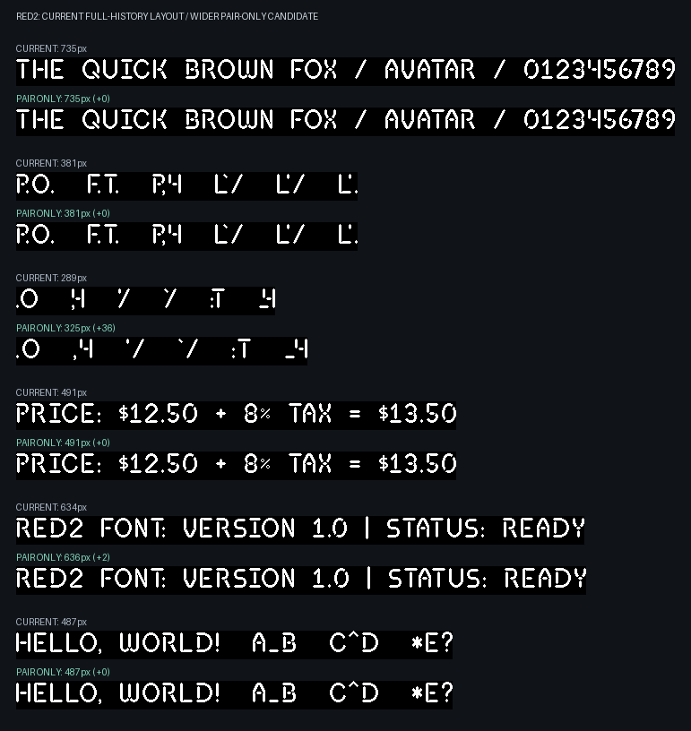

# Pair-only kerning feasibility

Current artwork: 85 glyphs (including .notdef), spacing 4px.

A triplet ABC requires A exactly when `d(A,C) > d(A,B) + d(B,C)`.
**627 / 614,125 triplets (0.102%) violate this.** All are listed in [dependent-triplets.csv](dependent-triplets.csv).

[Comparison image of every triplet](triplets-comparison.png) · [Image index and exact positions](triplets-comparison-index.csv). Each row shows original pairs without A's correction, current placement with A's correction, and the proposed wider pairs. C is colored. Row IDs match the CSV; rows are sorted by correction, largest first.

| Middle glyph B | Triplets | Largest correction |
| --- | ---: | ---: |
| U+002C (',') | 209 | 7px |
| U+002E ('.') | 209 | 7px |
| U+0060 ('`') | 82 | 8px |
| U+0027 ("'") | 51 | 7px |
| U+005F ('_') | 20 | 7px |
| U+003A (':') | 17 | 5px |
| U+003B (';') | 17 | 5px |
| U+0022 ('"') | 7 | 7px |
| U+003E ('>') | 6 | 2px |
| U+002D ('-') | 2 | 1px |
| U+003C ('<') | 2 | 1px |
| U+005E ('^') | 2 | 4px |
| U+007E ('~') | 2 | 1px |
| U+005C ('\\') | 1 | 1px |

## Wider candidate

Resolve a violation by increasing B/C to at least `d(A,C) - d(A,B)`, then repeat and exhaustively verify the entire table. This preserves clearance and produces a feasible table; it is not a global optimum. Every sweep visits A, B, and C in ascending glyph-key order and updates in place, independently of dictionary insertion order.

- 120 of 7,225 pair entries change (1.66%).
- Additions range from 1 to 8 pixels; 316 pixels total across the table.
- No advance exceeds its original nominal advance.
- Fixed-cell pairs remain unchanged.
- No triplets violate the inequality after widening. By induction, adjacent pairs now satisfy every earlier-glyph constraint for any string.

[Changed pairs](pair-changes.csv) · [Full proposed pair table](pair-advances.csv)

This changes the desired spacing: for example, a punctuation/letter pair widens even when no preceding glyph needs the extra room. Some triplets match their old contextual positions; others get wider. Existing default rendering and font exports are unchanged.

## Visual comparison

Each sample shows existing full-history placement above the wider candidate. Candidate placement uses the same full-history renderer; the exhaustive proof guarantees ordinary adjacent-pair layout gives identical origins.



| Sample | Current width | Pair-only width |
| --- | ---: | ---: |
| THE QUICK BROWN FOX / AVATAR / 0123456789 | 735px | 735px |
| P.O.  F.T.  P,4  L`/  L'/  L'. | 381px | 381px |
| .O  ,4  '/  `/  :T  _4 | 289px | 325px |
| PRICE: $12.50 + 8% TAX = $13.50 | 491px | 491px |
| RED2 FONT: VERSION 1.0 &#124; STATUS: READY | 634px | 636px |
| HELLO, WORLD!  A_B  C^D  *E? | 487px | 487px |

Regenerate from the repository root:

```sh
python -m src.analyze_kerning --spacing 4
```
