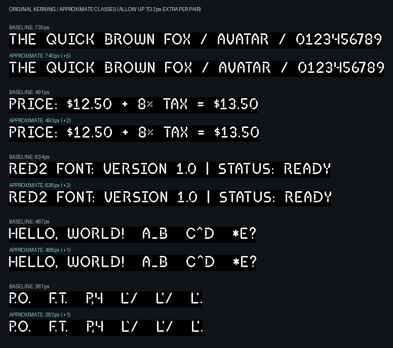

# Approximate kerning classes

**Kerning slack: 2px.** Allow up to 2 extra pixel(s) per pair, relative to the original, un-widened kerning table. Optional triangle widening is disabled. The required placement history is 2 preceding glyph(s). Extra space can accumulate across a string. The current font includes .notdef and fixed-cell symbols. Every pair involving a fixed-cell glyph is protected from additional widening.

For each class block, store the minimum original adjustment. Accept a merge only if its original maximum minus original minimum is <= N. Bounds refer to the original baseline, so repeated merges do not accumulate error beyond N. Glyph order, strategy order, and score tie breaks are deterministic.

## Measurements

| Source | Exact classes | Selected approximate classes | Changed pairs | Added pixels | Left lower bound | Right lower bound |
| --- | ---: | ---: | ---: | ---: | ---: | ---: |
| current-font (85 glyphs) | 56 x 51 | 29 x 29 | 665 | 790 | 27 | 25 |
| fpga-snapshot (73 glyphs) | 59 x 55 | 29 x 32 | 858 | 1069 | 28 | 29 |

Candidates are ranked first by power-of-two padded ROM capacity, then by the number of pairs at each pixel error, from largest to smallest. For slack 2 this prefers fewer +2px pairs, then fewer +1px pairs. Exact cell count, maximum dimension, and stable strategy order break remaining ties. Total widening is diagnostic, not the objective. Five deterministic greedy strategies are compared; this is not a proof of globally optimal class counts or error counts. The lower bounds are proven by explicit certificates: every pair of profiles in the corresponding JSON glyph list differs by more than N at some coordinate and therefore cannot share a class, independent of the heuristic or the opposite partition.

## current-font strategies

| Strategy | Left | Right | Cells | Padded cells | +1px pairs | +2px pairs | Added pixels | History valid | Dependent triplets |
| --- | ---: | ---: | ---: | ---: | ---: | ---: | ---: | --- | ---: |
| balanced | 28 | 29 | 812 | 1024 | 559 | 165 | 889 | True | 510 |
| area | 28 | 29 | 812 | 1024 | 613 | 152 | 917 | True | 505 |
| pixels | 28 | 29 | 812 | 1024 | 613 | 152 | 917 | True | 505 |
| left-first | 29 | 29 | 841 | 1024 | 540 | 125 | 790 | True | 521 |
| right-first | 30 | 27 | 810 | 1024 | 603 | 173 | 949 | True | 441 |

[Class definitions and lower-bound certificates](current-font.json) · [Full decoded pair table](current-font-pair-advances.csv)

## fpga-snapshot strategies

| Strategy | Left | Right | Cells | Padded cells | +1px pairs | +2px pairs | Added pixels | History valid | Dependent triplets |
| --- | ---: | ---: | ---: | ---: | ---: | ---: | ---: | --- | ---: |
| balanced | 29 | 32 | 928 | 1024 | 647 | 211 | 1069 | True | 682 |
| area | 29 | 32 | 928 | 1024 | 647 | 211 | 1069 | True | 682 |
| pixels | 29 | 32 | 928 | 1024 | 647 | 211 | 1069 | True | 682 |
| left-first | 29 | 33 | 957 | 2048 | 652 | 199 | 1050 | True | 679 |
| right-first | 33 | 31 | 1023 | 2048 | 658 | 168 | 994 | True | 689 |

[Class definitions and lower-bound certificates](fpga-snapshot.json) · [Full decoded pair table](fpga-snapshot-pair-advances.csv)

## History invariant

Without --widen-pairs, approximation starts directly from the original advances and is checked against the existing exhaustive four-glyph proof that two predecessors suffice. Remaining dependent triplets are allowed. Each distinct decoded candidate is checked; duplicate candidates share a proof result. Only valid candidates are eligible for selection. With --widen-pairs, the stronger exhaustive three-glyph triangle proof is required instead.

Arbitrary positive per-pair errors do not preserve the triangle invariant. When the baseline already satisfies it, this aggregation does: a column merge replaces an advance by the maximum over the merged destination glyphs. The original triangle inequality then gives D'(A,C) <= D(A,B) + D'(B,C) <= D'(A,B) + D'(B,C). Row merging has the same proof after subtracting each source glyph's nominal advance. Both operations commute as minima of adjustment blocks. This does not imply preservation of the weaker two-predecessor invariant; that property is checked independently as described above.

## BRAM implications

The selected current-font candidate needs 5-bit left IDs and 5-bit right IDs. Actual class cells decrease from 2,856 to 841 (70.6% fewer). The existing FPGA code still pads the table to 64 x 64 x 4 bits (one RAMB18). Tightly storing the actual class cells uses fewer bits, but needs a different ROM layout. There is no automatic physical BRAM reduction with the existing padded addressing.

## Preview



Production renderer and FPGA exporter defaults are unchanged.

Regenerate from the font repository root:

```sh
python -m src.approximate_kerning_classes --kerning-slack 2 --fpga-rom ../fpgatool/examples/hardware/red2_row_data.py
```
