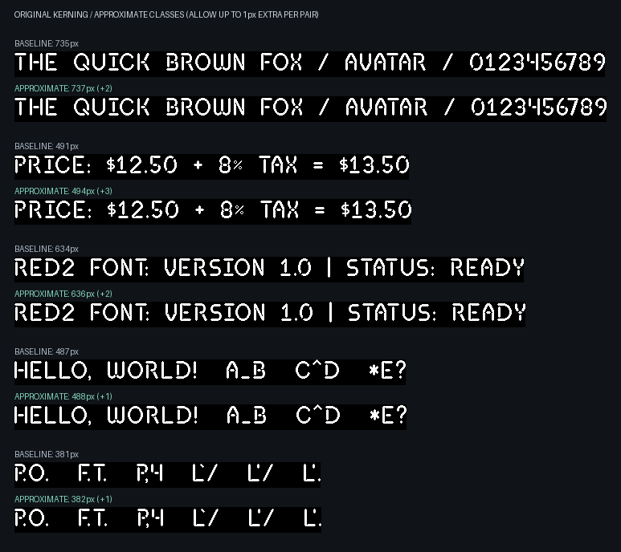

# Approximate kerning classes

Allow up to **1 extra pixel(s) per pair**, relative to the original, un-widened kerning table. Optional triangle widening is disabled. The required placement history is 2 preceding glyph(s). Extra space can accumulate across a string. The current font includes .notdef and fixed-cell symbols. Every pair involving a fixed-cell glyph is protected from additional widening.

For each class block, store the minimum original adjustment. Accept a merge only if its original maximum minus original minimum is <= N. Bounds refer to the original baseline, so repeated merges do not accumulate error beyond N. Glyph order, strategy order, and score tie breaks are deterministic.

## Measurements

| Source | Exact classes | Selected approximate classes | Changed pairs | Added pixels | Left lower bound | Right lower bound |
| --- | ---: | ---: | ---: | ---: | ---: | ---: |
| current-font (85 glyphs) | 56 x 51 | 40 x 37 | 382 | 382 | 39 | 37 |
| fpga-snapshot (73 glyphs) | 59 x 55 | 44 x 41 | 444 | 444 | 44 | 41 |

The selected candidate minimizes cell count among five deterministic greedy strategies. This is not a proof of optimal class counts. The lower bounds are proven by explicit certificates: every pair of profiles in the corresponding JSON glyph list differs by more than N at some coordinate and therefore cannot share a class, independent of the heuristic or the opposite partition.

## current-font strategies

| Strategy | Left | Right | Cells | Added pixels | History valid | Dependent triplets |
| --- | ---: | ---: | ---: | ---: | --- | ---: |
| balanced | 40 | 37 | 1480 | 382 | True | 549 |
| area | 40 | 37 | 1480 | 382 | True | 549 |
| pixels | 40 | 37 | 1480 | 382 | True | 549 |
| left-first | 39 | 38 | 1482 | 384 | True | 548 |
| right-first | 41 | 37 | 1517 | 376 | True | 566 |

[Class definitions and lower-bound certificates](current-font.json) · [Full decoded pair table](current-font-pair-advances.csv)

## fpga-snapshot strategies

| Strategy | Left | Right | Cells | Added pixels | History valid | Dependent triplets |
| --- | ---: | ---: | ---: | ---: | --- | ---: |
| balanced | 44 | 41 | 1804 | 450 | True | 895 |
| area | 44 | 41 | 1804 | 450 | True | 895 |
| pixels | 44 | 41 | 1804 | 450 | True | 895 |
| left-first | 44 | 41 | 1804 | 450 | True | 895 |
| right-first | 44 | 41 | 1804 | 444 | True | 903 |

[Class definitions and lower-bound certificates](fpga-snapshot.json) · [Full decoded pair table](fpga-snapshot-pair-advances.csv)

## History invariant

Without --widen-pairs, approximation starts directly from the original advances and is checked against the existing exhaustive four-glyph proof that two predecessors suffice. Remaining dependent triplets are allowed. Each distinct decoded candidate is checked; duplicate candidates share a proof result. Only valid candidates are eligible for selection. With --widen-pairs, the stronger exhaustive three-glyph triangle proof is required instead.

Arbitrary positive per-pair errors do not preserve the triangle invariant. When the baseline already satisfies it, this aggregation does: a column merge replaces an advance by the maximum over the merged destination glyphs. The original triangle inequality then gives D'(A,C) <= D(A,B) + D'(B,C) <= D'(A,B) + D'(B,C). Row merging has the same proof after subtracting each source glyph's nominal advance. Both operations commute as minima of adjustment blocks. This does not imply preservation of the weaker two-predecessor invariant; that property is checked independently as described above.

## BRAM implications

The selected current-font candidate needs 6-bit left IDs and 6-bit right IDs. Actual class cells decrease from 2,856 to 1,480 (48.2% fewer). The existing FPGA code still pads the table to 64 x 64 x 4 bits (one RAMB18). Tightly storing the actual class cells uses fewer bits, but needs a different ROM layout. There is no automatic physical BRAM reduction with the existing padded addressing.

## Preview



Production renderer and FPGA exporter defaults are unchanged.

Regenerate from the font repository root:

```sh
python -m src.approximate_kerning_classes --kerning-slack 1 --fpga-rom ../fpgatool/examples/hardware/red2_row_data.py
```
